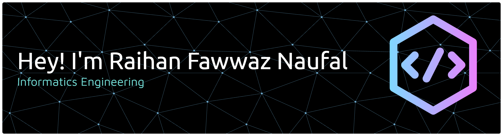

<!-- ## Hi there I'm Raihan Fawwaz Naufal 👋 -->

<!-- - 🔭 I’m currently exploring Data Science, Machine Learning, and AI-driven projects.
- 🌱 I’m currently learning more about Python, Data Analytics, Machine Learning, and Deep Learning.
- 👯 I’m looking to collaborate on Data Science, Data Analytics, and AI-related projects.
- 🤔 I’m looking to improve my skills in data analysis, predictive modeling, and data visualization.
- 💬 Ask me about Python, SQL, Machine Learning, Data Analysis, Web Scraping, and LLMs.
- 📫 How to reach me: raihanfawzn30@gmail.com
- 😄 Pronouns: He/Him
- ⚡ Fun fact: I enjoy turning raw data into meaningful insights and exploring how AI can solve real-world problems.

##### Skills

##### Database

##### Framework

##### IDE

##### Connect with me

 -->

### Hi there I'm Raihan Fawwaz Naufal 👋

##### Socials:
  

##### 💻 Tech Stack:
             

##### 📊 GitHub Stats:
 
 
